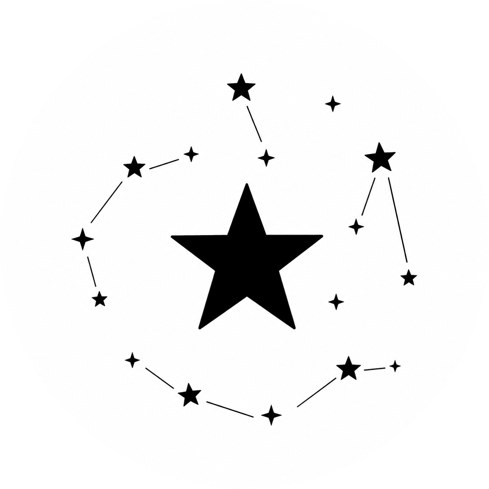

<div align="center">



# Astro-star

**An open-source Astro theme that brings blogs, notes, projects, comments, and friend links into one personal site.**

[](https://astro.build)
[](https://nodejs.org)
[](https://pnpm.io)
[](./LICENSE)
[](./CONTRIBUTING.md)

English · [简体中文](./README-zh-CN.md)

<a href="./CONTRIBUTING.md">🤝 Contributing</a> &nbsp;·&nbsp;
<a href="https://github.com/hanlife02/Astro-star/issues">🐛 Issues</a> &nbsp;·&nbsp;
<a href="https://hanlife02.com/project/astro-star">📖 Docs</a>

</div>

---

## Table of Contents

- [Astro-star](#astro-star)
  - [Table of Contents](#table-of-contents)
  - [Project Map](#project-map)
  - [Introduction and Deployment](#introduction-and-deployment)
  - [Build Together](#build-together)
  - [Tech Stack](#tech-stack)
  - [Sites Using This Theme](#sites-using-this-theme)
  - [Discussion and Exchange](#discussion-and-exchange)
  - [License](#license)
  - [Star History](#star-history)

## Project Map

```text
/
├── public/                 # Static assets, avatars, site icon, article images
├── scripts/                # Config migration, index sync, and build helpers
├── src/
│   ├── components/         # Reusable components
│   ├── config/             # Site, social links, friend links, and search config
│   ├── content/            # blog / note / project / page content collections
│   ├── layouts/            # Page layouts
│   ├── pages/              # Routes and API endpoints
│   ├── scripts/            # Browser-side interaction scripts
│   ├── style/              # Global styles, component styles, design tokens
│   └── utils/              # Markdown, MDX, and shared utilities
├── astro.config.mjs
├── ecosystem.config.cjs
└── package.json
```

Top-level routes:

| Path       | Description  |
| ---------- | ------------ |
| `/`        | Home         |
| `/about`   | About        |
| `/blog`    | Blog         |
| `/note`    | Notes        |
| `/project` | Projects     |
| `/links`   | Friend links |

## Introduction and Deployment

See [Introduction and Deployment of Astro-star](https://hanlife02.com/project/astro-star/).

### Publication notifications

The footer links to `/subscribe/`. The page offers RSS and any enabled push channels. Email and Bark readers confirm through a link. Telegram readers subscribe with `/start` and leave with `/stop`.

Create a private `.env.subscriptions` beside `server-start.mjs` on the server. Set only the channels you offer and use your public site address for `site.site.url` in `src/config/site.ts`.

```dotenv
# Email. Port 465 uses implicit TLS. Other ports require STARTTLS.
SUBSCRIPTIONS_SMTP_HOST=smtp.example.com
SUBSCRIPTIONS_SMTP_PORT=587
SUBSCRIPTIONS_SMTP_FROM=blog@example.com
SUBSCRIPTIONS_SMTP_USER=blog@example.com
SUBSCRIPTIONS_SMTP_PASSWORD=replace-me

# Telegram. Use a dedicated bot and a random secret (openssl rand -hex 32).
SUBSCRIPTIONS_TELEGRAM_BOT_USERNAME=example_blog_bot
SUBSCRIPTIONS_TELEGRAM_BOT_TOKEN=replace-me
SUBSCRIPTIONS_TELEGRAM_WEBHOOK_SECRET=replace-me

# Bark's public api.day.app service
SUBSCRIPTIONS_BARK=true
```

After building, start with `pnpm start` or restart the existing PM2 app. For Telegram, register the webhook once using your public HTTPS domain. Export the bot token and webhook secret from the environment file before running this command.

```sh
curl -fsS "https://api.telegram.org/bot${SUBSCRIPTIONS_TELEGRAM_BOT_TOKEN}/setWebhook" \
  --data-urlencode 'url=https://example.com/api/subscriptions/telegram' \
  --data-urlencode "secret_token=${SUBSCRIPTIONS_TELEGRAM_WEBHOOK_SECRET}" \
  --data-urlencode 'allowed_updates=["message"]' \
  --data-urlencode 'max_connections=1'
```

On first startup, the worker records the current blog posts, notes, and projects. Subsequent deployments queue notifications for newly published entries. Edits to existing entries and drafts are skipped. SQLite defaults to `.subscriptions/subscriptions.sqlite`. The bundled deployment preserves that directory and `.env.subscriptions`. To use a different storage location, set `SUBSCRIPTIONS_DB_PATH` to a writable path outside the deploy directory.

## Build Together

Small contributions are welcome. A clear Issue, a mobile screenshot, a reproducible bug, a more ergonomic component, or a short setup note can all make this theme easier to maintain and reuse.

Before opening a PR, it is recommended to run:

```bash
pnpm check
pnpm format:check
pnpm build
```

See [CONTRIBUTING.md](./CONTRIBUTING.md) for the core rules. The most important ones are: do not hard-code business content in components, keep styles in `src/style/`, build mobile-first, and never commit secrets.

## Tech Stack

<div align="center">

[](https://astro.build)
[](https://www.typescriptlang.org)
[](https://mdxjs.com)
[](https://waline.js.org)
[](https://www.algolia.com)

</div>

## Sites Using This Theme

Welcome to use this theme for your personal site! Submit a PR to add your site to the list.

| Avatar                                                    | Site                           | Description                    |
| --------------------------------------------------------- | ------------------------------ | ------------------------------ |
|  | [Ethan](https://hanlife02.com) | Don't stay awake for too long. |

## Discussion and Exchange

Welcome to participate in discussions, feedback issues, and feature suggestions in the [LINUX DO](https://linux.do) community.

## License

Astro-star is open-source under the [MIT License](./LICENSE).

## Star History

<a href="https://www.star-history.com/?repos=hanlife02%2FAstro-star&type=date&legend=top-left">
 <picture>
   <source media="(prefers-color-scheme: dark)" srcset="https://api.star-history.com/chart?repos=hanlife02/Astro-star&type=date&theme=dark&legend=top-left&sealed_token=SUzwHN5ZdCscIYlMbiRmw-j7ttKNlySwP5lTx0DRCE2cuY8mqab0dfXSD1kB0SzYvpNKvi83I8ogVp-jGSuX3VYtGFuf55k0vfIOyw2LU1JAYkkGGneifgvI_Egn2A-qH96gWrbfFlczWOcpRE8r2Cgqfc1cR75IISNQZbodN6x4P42-x6sdlRn5lcya" />
   <source media="(prefers-color-scheme: light)" srcset="https://api.star-history.com/chart?repos=hanlife02/Astro-star&type=date&legend=top-left&sealed_token=SUzwHN5ZdCscIYlMbiRmw-j7ttKNlySwP5lTx0DRCE2cuY8mqab0dfXSD1kB0SzYvpNKvi83I8ogVp-jGSuX3VYtGFuf55k0vfIOyw2LU1JAYkkGGneifgvI_Egn2A-qH96gWrbfFlczWOcpRE8r2Cgqfc1cR75IISNQZbodN6x4P42-x6sdlRn5lcya" />
   
 </picture>
</a>

---

<div align="center">

If you find this project helpful, consider giving it a ⭐ to show your support!

</div>
