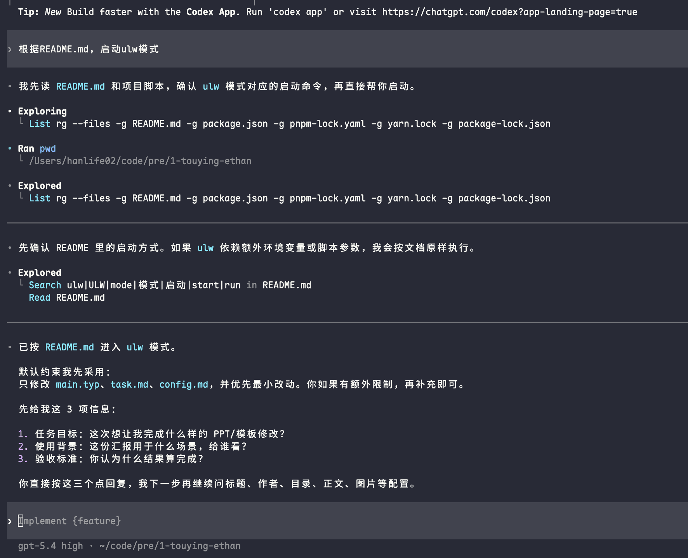
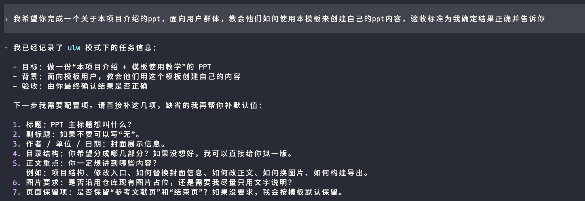
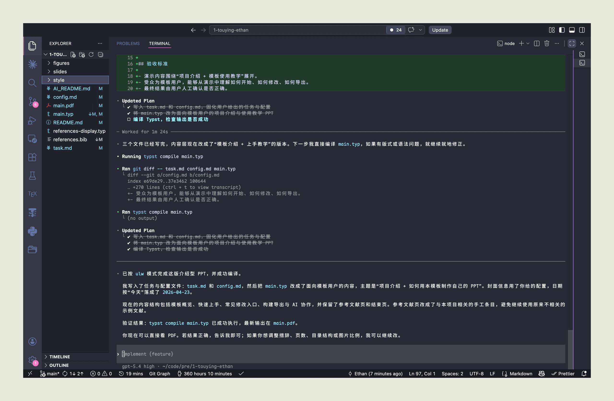

[touying-ethan](https://github.com/hanlife02/touying-ethan)

## 前言

为了应付日益增长的slides制作需求，我创建了touying-ethan这个项目，旨在与ai更好地协作帮忙完成slides的制作。

## 使用示例

### 1. clone此repo到本地

```shell
git clone https://github.com/hanlife02/touying-ethan.git
cd touying-ethan
```

### 2. 打开agent(这里使用codex示例)

```shell
codex
```

### 3. 输入提示词






### 4. 预览效果

这里提供上述提示词生成的slides

[查看 PDF 预览](/figures/touying-ethan.pdf)
